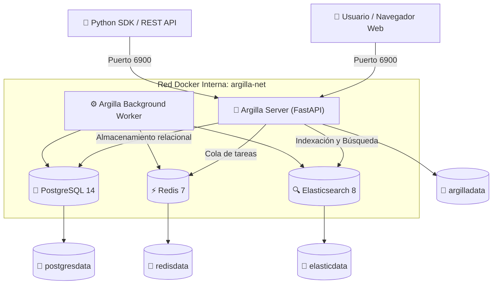

# Despliegue Desatendido de Argilla con Docker

Este repositorio proporciona una solución robusta y completamente automatizada para la **instalación desatendida de la plataforma de anotación [Argilla](https://argilla.io/)** utilizando **Docker** y **Docker Compose**.

Diseñado para despliegues en servidores, entornos locales de desarrollo y laboratorios docentes (UGR-NLP).

---

##  Arquitectura del Despliegue

La pila se compone de servicios aislados y coordinados mediante comprobaciones de salud (*healthchecks*):



---

## ⚡ Requisitos Previos

- **Docker Engine** (v20.10 o superior)
- **Docker Compose** (plugin v2 o standalone)
- **Memoria RAM disponible:** Mínimo 2 GB libres (Elasticsearch y Argilla).

---

## 🚀 Instalación y Despliegue Multiplataforma

El instalador detecta automáticamente si el sistema es **macOS** (Apple Silicon / Intel), **Microsoft Windows** (PowerShell, Git Bash o WSL2) o **GNU/Linux**, aplicando las configuraciones diferenciales necesarias (por ejemplo, deshabilitando banderas exclusivas de procesadores ARM en máquinas x86/Windows para evitar fallos de Java).

### En macOS y Linux (Bash / Make)

```bash
# Instalación estándar interactiva / desatendida
./install.sh

# O mediante make:
make install
```

### En Microsoft Windows (PowerShell Nativo)

El instalador desatendido [install.ps1](file:///Users/alejandro/Documents/LEARN/UGR/UGR-NLP/Argilla-docker/install.ps1) está optimizado para entornos nativos de Microsoft Windows (PowerShell 5.1 y PowerShell 7+):
- **Parámetros no sensibles a mayúsculas/minúsculas:** Compatible con la convención de PowerShell (`-Port`, `-Password` / `-pwd` / `-pass`, `-ApiKey`, `-Workspace`, `-Clean`, etc.).
- **Gestión automática de Docker Desktop:** Comprueba el estado del demonio Docker y de Docker Compose sin requerir herramientas Unix externas.
- **Configuración diferencial:** Aplica el perfil de JVM adecuado para Windows/x86_64 evitando parámetros incompatibles de procesadores ARM.

Abra PowerShell en la carpeta del proyecto y ejecute:

```powershell
.\install.ps1
```

> [!TIP]
> Si la directiva de ejecución de PowerShell restringe la ejecución de scripts locales, ejecute:  
> `powershell -ExecutionPolicy Bypass -File .\install.ps1`

También puede utilizar **Git Bash** o **WSL2** en Windows ejecutando directamente `./install.sh`.

---

## 🧹 Rol Dual: Instalador y Limpiador de Datos Anteriores

Una causa habitual de confusión al trabajar con Argilla es que al eliminar o detener el contenedor, **las actividades y anotaciones previas persisten en los volúmenes de Docker**.

El nuevo proceso de instalación detecta si existen actividades previas y ofrece gestionarlas:

1. **Detección inteligente de datos:** Detecta si existen volúmenes persistentes de bases de datos (`postgresdata`, `elasticdata`, `redisdata`, `argilladata`).
2. **Opción de limpieza total:** Pregunta al usuario si desea eliminar toda la información anterior para comenzar desde cero.
3. **Rol como "Limpiador" independiente:** Tras la limpieza, pregunta si desea proceder con una nueva instalación o si solo deseaba limpiar el sistema (`[S/n]`).
4. **Descarga selectiva:** Comprueba si las imágenes ya existen en la caché local de Docker antes de descargarlas, evitando transferencias innecesarias de red.

### Comandos de Limpieza Rápida:

```bash
# En macOS / Linux / Git Bash:
./install.sh --clean -y         # Reinstalación 100% limpia y desatendida (elimina datos previos)
./install.sh --clean-only -y    # Usar como LIMPIADOR exclusivo (borra datos y finaliza sin instalar)
make clean-install              # Vía Makefile: reinstalación desde cero
make clean-only                 # Vía Makefile: limpiador exclusivo

# En Microsoft Windows (PowerShell):
.\install.ps1 -Clean -Yes       # Reinstalación 100% limpia
.\install.ps1 -CleanOnly -Yes   # Limpiador exclusivo (borra volúmenes y finaliza)
```


---

## 🔑 Credenciales y Acceso por Defecto

Una vez completada la instalación, acceda a través de su navegador web:

- **URL de la Interfaz Web:** [http://localhost:6900](http://localhost:6900)
- **Endpoint API REST:** [http://localhost:6900/api/v1](http://localhost:6900/api/v1)
- **Usuario:** `argilla`
- **Contraseña:** `12345678`
- **API Key:** `argilla.apikey`
- **Espacio de trabajo (Workspace):** `default`

---

## 🔧 Gestión de Datasets y Anotaciones

El proyecto ofrece herramientas interactivas mediante **Jupyter Notebooks** y scripts automatizados en **Python** para crear datasets, importar datos desde Hugging Face, cargar archivos locales `.jsonl`, monitorear el progreso de anotación y exportar los resultados curados.

### 1. Preparación del Entorno Virtual

Para ejecutar los cuadernos interactivos y los scripts, active el entorno virtual e instale las dependencias recomendadas:

```bash
# Crear el venv local
python3 -m venv .venv

# Activar el entorno en macOS / Linux:
source .venv/bin/activate

# Activar el entorno en Windows (PowerShell):
.\.venv\Scripts\Activate.ps1

# Instalar dependencias necesarias (Argilla, Datasets de Hugging Face y Jupyter)
pip install --upgrade pip
pip install argilla datasets jupyter
```

---

### 2. Cuadernos Interactivos (Jupyter Notebooks)

#### 📓 [cargar-datos-hf.ipynb](file:///Users/alejandro/Documents/LEARN/UGR/UGR-NLP/Argilla-docker/cargar-datos-hf.ipynb): Carga de Datasets Públicos de Hugging Face
Permite volcar registros desde cualquier dataset público alojado en [Hugging Face](https://huggingface.co/datasets) (por ejemplo, `FineEnvs/openai-math`) hacia su contenedor correspondiente en Argilla.

**Flujo de trabajo requerido:**
1. **Creación previa del contenedor en la UI:** Abra la interfaz web de Argilla (`http://localhost:6900`), inicie sesión y seleccione la opción **"Import from Hugging Face"**. Indique el identificador del repositorio de Hugging Face para que Argilla configure automáticamente el esquema de preguntas y campos del dataset.
2. **Carga y sincronización vía Notebook:** Abra `cargar-datos-hf.ipynb`. El cuaderno descarga el split deseado mediante la librería `datasets` (`load_dataset(...)`), conecta con la API de Argilla y envía los registros masivamente al dataset previamente creado usando `dataset.records.log(ds, mapping={})`.

#### 📓 [cargar-datos-jsonl.ipynb](file:///Users/alejandro/Documents/LEARN/UGR/UGR-NLP/Argilla-docker/cargar-datos-jsonl.ipynb): Creación, Carga y Exportación desde JSONL
Cuaderno interactivo todo-en-uno estructurado en celdas preparadas para gestionar el ciclo completo de anotación local:
1. **Creación del Dataset y Carga de Registros:**
   - Lee el archivo `train-dataset1/train.jsonl`.
   - Descubre dinámicamente el catálogo de etiquetas para tareas de tipo `choice`.
   - Configura el dataset en Argilla (`telco_multitask_evaluation`) definiendo directrices, campos (`text`, `task_instructions`, `criteria_guide`) y preguntas de anotación (`review_status`, `department`, `binary_confirmation`, `frustration_score`).
   - Envía los registros en lotes (*batches* de 100) incluyendo sugerencias pre-cargadas basadas en `target` para agilizar la anotación.
2. **Exportación de Datos Curados a JSONL Local:**
   - Consulta los registros del dataset incluyendo las respuestas guardadas por los anotadores (`with_responses=True`).
   - Exporta los datos consolidados directamente a un archivo local `.jsonl` (`train-dataset1/annotated.jsonl`), listo para tareas de entrenamiento o evaluación de modelos.

---

### 3. Scripts Python Disponibles

Para ejecución directa desde terminal o flujos de trabajo automatizados:

- **`upload_to_argilla.py` / `cargar-datos-jsonl.py` (Carga inicial):** Script de consola que crea el dataset y sube los registros de `train-dataset1/train.jsonl` con preguntas y sugerencias predefinidas.
  ```bash
  python upload_to_argilla.py
  ```
- **`cargar-datos-hf-terminal-hf.py` (Carga desde Hugging Face):** Script en línea de comandos para sincronizar registros desde Hugging Face hacia un dataset importado previamente en Argilla.
  ```bash
  python cargar-datos-hf-terminal-hf.py
  ```
- **`comprobar.py` (Verificación de estado de anotación):** Consulta la base de datos de Argilla e imprime un resumen en consola sin necesidad de abrir el navegador:
  - Conteo de registros anotados (`responses`) vs. pendientes.
  - Identificación de los anotadores activos (`user_id`).
  ```bash
  python comprobar.py
  ```
- **`exportarr-anotados.py` (Exportación estructurada):** Extrae las respuestas guardadas del dataset, procesa cada tipo de tarea (`choice`, `noul`, `score`), aplica sugerencias como respaldo (*fallback*) y genera el archivo `train-dataset1/train_annotated.jsonl`.
  ```bash
  python exportarr-anotados.py
  ```


---

## ⚙️ Opciones de Personalización

Puede personalizar los parámetros pasando argumentos al instalador o modificando el archivo `.env`:

### Parámetros de línea de comandos en `install.sh` y `install.ps1`

```bash
# macOS / Linux / Git Bash:
./install.sh -p 7000 -P "MiClaveSuperSegura" -k "mi.clave.api.personalizada" -w "mi-workspace"

# Microsoft Windows (PowerShell):
.\install.ps1 -Port 7000 -Password "MiClaveSuperSegura" -ApiKey "mi.clave.api.personalizada"
```

| Opción Bash | Opción PowerShell | Descripción | Valor por defecto |
| :--- | :--- | :--- | :--- |
| `-p`, `--port` | `-Port` | Puerto expuesto en el host | `6900` |
| `-u`, `--user` | `-User` | Nombre del usuario administrador | `argilla` |
| `-P`, `--password` | `-Password` (alias: `-pwd`, `-pass`) | Contraseña del usuario administrador | `12345678` |
| `-k`, `--api-key` | `-ApiKey` | API Key para autenticación en clientes | `argilla.apikey` |
| `-w`, `--workspace` | `-Workspace` | Espacio de trabajo inicial | `default` |
| `-t`, `--timeout` | `-Timeout` | Tiempo máximo de espera en segundos para arranque | `180` |
| `--clean` | `-Clean` | Borra datos/volúmenes previos y reinstala | Desactivado |
| `--clean-only` | `-CleanOnly` | Modo limpiador: solo borra datos previos y finaliza | Desactivado |
| `--keep-data` | `-KeepData` | Conserva datos anteriores sin consultar al usuario | Desactivado |
| `--pull` | `-Pull` | Fuerza descarga de imágenes aunque existan en local | Desactivado |
| `-y`, `--yes` | `-Yes` | Responde automáticamente 'Sí' a las confirmaciones | Desactivado |
| `--no-wait` | `-NoWait` | No esperar a que los servicios estén listos | Desactivado |
| `-h`, `--help` | `-Help` | Muestra la ayuda en pantalla | — |

### Variables de Entorno (`.env`)

El archivo `.env` permite configurar ajustes adicionales:

```env
ARGILLA_VERSION=latest
ARGILLA_PORT=6900
ARGILLA_USER=argilla
ARGILLA_PASSWORD=12345678
ARGILLA_API_KEY=argilla.apikey
ARGILLA_WORKSPACE=default
HF_HUB_DISABLE_TELEMETRY=1
BACKGROUND_NUM_WORKERS=2
POSTGRES_USER=postgres
POSTGRES_PASSWORD=postgres
POSTGRES_DB=argilla
ES_HEAP_SIZE=512m
# Configurado automáticamente por el instalador (-XX:UseSVE=0 para Apple Silicon)
ES_JAVA_OPTS_EXTRA=
```

---

## 🛠️ Comandos de Gestión y Mantenimiento

Se incluyen scripts tanto para Unix/Bash como para PowerShell (Windows) y atajos de `Makefile`:

| Acción | Bash (macOS/Linux) | PowerShell (Windows) | Vía Make | Descripción |
| :--- | :--- | :--- | :--- | :--- |
| **Instalación estándar** | `./install.sh` | `.\install.ps1` | `make install` | Instalación guiada / inteligente |
| **Instalación limpia** | `./install.sh --clean -y` | `.\install.ps1 -Clean -Yes` | `make clean-install` | Borra datos previos y reinstala |
| **Limpiador exclusivo** | `./install.sh --clean-only -y`| `.\install.ps1 -CleanOnly -Yes` | `make clean-only` | Saneamiento total de datos previos |
| **Iniciar** | `./start.sh` | `.\start.ps1` | `make start` | Inicia contenedores existentes |
| **Detener** | `./stop.sh` | `.\stop.ps1` | `make stop` | Pausa contenedores (los datos se conservan) |
| **Reiniciar** | `./restart.sh` | `.\restart.ps1` | `make restart` | Reinicia todos los servicios |
| **Consultar estado** | `./status.sh` | `.\status.ps1` | `make status` | Muestra estado de contenedores y salud del API |
| **Ver logs** | `docker compose logs -f` | `docker compose logs -f` | `make logs` | Registros en tiempo real de todos los servicios |
| **Logs del servidor** | `docker compose logs -f argilla` | `docker compose logs -f argilla` | `make logs-server` | Registros del backend Argilla |
| **Logs de Elasticsearch** | `docker compose logs -f elasticsearch` | `docker compose logs -f elasticsearch` | `make logs-es` | Registros de Elasticsearch |
| **Probar API REST** | `bash examples/quick_test.sh` | `Invoke-RestMethod ...` | `make test` | Prueba de endpoints |
| **Probar cliente Python**| `python3 examples/test_client.py` | `python examples\test_client.py` | `make test-python` | Validación con SDK Python |
| **Desinstalar (conservar datos)** | `./uninstall.sh` | `.\uninstall.ps1` | `make clean` | Elimina contenedores y redes |
| **Desinstalación total** | `./uninstall.sh --volumes --yes` | `.\uninstall.ps1 -Volumes -Yes` | `make clean-all` | Elimina contenedores y **volúmenes de datos** |

---

## 🧪 Pruebas y Validación

### 1. Prueba rápida de API (sin dependencias externas)
```bash
make test
```
Verifica la disponibilidad de `/api/v1/version`, el usuario autenticado `/api/v1/me` y los workspaces disponibles.

### 2. Uso mediante el SDK oficial de Argilla (Python)
Para interactuar con Argilla desde scripts o notebooks en Python:

```bash
pip install argilla
```

```python
import argilla as rg

# Inicialización del cliente en Argilla v2
client = rg.Argilla(api_url="http://localhost:6900", api_key="argilla.apikey")

# Listar espacios de trabajo
workspaces = list(client.workspaces)
print(f"Workspaces disponibles: {[ws.name for ws in workspaces]}")
```

Puede ejecutar el script de prueba incluido:
```bash
make test-python
```

---

## ❓ Solución de Problemas Frecuentes

### 1. Elasticsearch falla al iniciar en Linux (`max virtual memory areas vm.max_map_count [65530] is too low`)
Elasticsearch requiere un valor mínimo de `262144` para `vm.max_map_count`. El script `install.sh` intenta aplicarlo automáticamente. Si es necesario aplicarlo manualmente:
```bash
sudo sysctl -w vm.max_map_count=262144
echo "vm.max_map_count=262144" | sudo tee -a /etc/sysctl.d/99-argilla.conf
```

### 2. El puerto 6900 ya está en uso
Cambie el puerto en el archivo `.env` o páselo como parámetro:
```bash
./install.sh -p 7000
```
Y acceda a través de `http://localhost:7000`.

### 3. El demonio de Docker no está activo
En macOS o Windows, inicie la aplicación Docker Desktop. En Linux:
```bash
sudo systemctl start docker
```

---

## 📄 Licencia

Este proyecto está bajo la licencia [MIT](LICENSE).