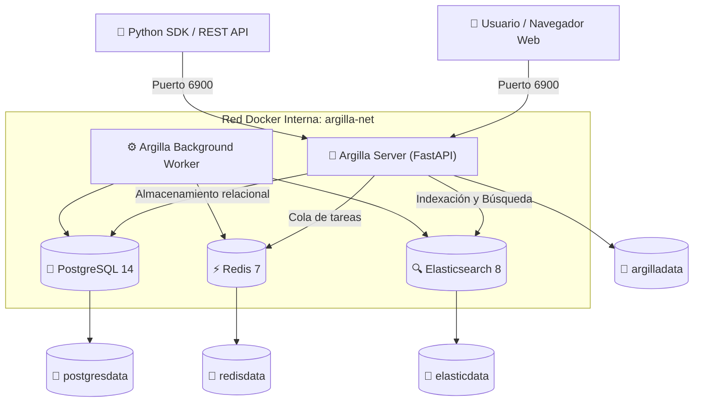

# Despliegue Desatendido de Argilla con Docker

Este repositorio proporciona una solución robusta y completamente automatizada para la **instalación desatendida de la plataforma de anotación [Argilla](https://argilla.io/)** utilizando **Docker** y **Docker Compose**.

Diseñado para despliegues en servidores, entornos locales de desarrollo y laboratorios docentes (UGR-NLP).

---

##  Arquitectura del Despliegue

La pila se compone de servicios aislados y coordinados mediante comprobaciones de salud (*healthchecks*):



---

## ⚡ Requisitos Previos

- **Docker Engine** (v20.10 o superior)
- **Docker Compose** (plugin v2 o standalone)
- **Memoria RAM disponible:** Mínimo 2 GB libres (Elasticsearch y Argilla).

---

##  Instalación Desatendida en 1 Comando

Para instalar y arrancar la pila de Argilla de forma 100% desatendida con la configuración estándar:

```bash
./install.sh
```

O si prefiere utilizar `make`:

```bash
make install
```

### ¿Qué realiza el instalador desatendido?
1. **Comprobación de requisitos:** Valida la disponibilidad de Docker, Docker Compose, el estado del demonio y la disponibilidad del puerto.
2. **Ajuste automático en Linux:** Comprueba `vm.max_map_count` (necesario para Elasticsearch) y lo configura si se tienen permisos.
3. **Generación de entorno:** Crea automáticamente el archivo `.env` a partir de `.env.example` si no existe.
4. **Descarga y arranque:** Descarga las imágenes oficiales e inicia los contenedores en segundo plano (`docker compose up -d`).
5. **Espera activa y validación de salud:** Sondea el endpoint `/api/v1/version` y `/api/v1/me` hasta verificar que tanto el servidor web como la base de datos y el motor de búsqueda estén listos para operar.
6. **Muestra resumen de acceso:** Imprime las credenciales, URLs y comandos útiles.

---

## 🔑 Credenciales y Acceso por Defecto

Una vez completada la instalación, acceda a través de su navegador web:

- **URL de la Interfaz Web:** [http://localhost:6900](http://localhost:6900)
- **Endpoint API REST:** [http://localhost:6900/api/v1](http://localhost:6900/api/v1)
- **Usuario:** `argilla`
- **Contraseña:** `12345678`
- **API Key:** `argilla.apikey`
- **Espacio de trabajo (Workspace):** `default`

---

## 🔧 Cargar dataset de prueba

# Crear el venv local
python3 -m venv .venv

# Activar el entorno
source .venv/bin/activate

# Instalar dependencias
pip install --upgrade pip
pip install argilla

# Ejecutar la carga
python upload_to_argilla.py

---

## ⚙️ Opciones de Personalización

Puede personalizar los parámetros pasando argumentos al instalador o modificando el archivo `.env`:

### Parámetros de línea de comandos en `install.sh`

```bash
./install.sh -p 7000 -P "MiClaveSuperSegura" -k "mi.clave.api.personalizada" -w "mi-workspace"
```

| Opción | Descripción | Valor por defecto |
| :--- | :--- | :--- |
| `-p`, `--port` | Puerto expuesto en el host | `6900` |
| `-u`, `--user` | Nombre del usuario administrador | `argilla` |
| `-P`, `--password` | Contraseña del usuario administrador | `12345678` |
| `-k`, `--api-key` | API Key para autenticación en clientes | `argilla.apikey` |
| `-w`, `--workspace` | Espacio de trabajo inicial | `default` |
| `-t`, `--timeout` | Tiempo máximo de espera en segundos para arranque | `180` |
| `--no-wait` | No esperar a que los servicios estén listos | Desactivado |
| `-h`, `--help` | Muestra la ayuda en pantalla | — |

### Variables de Entorno (`.env`)

El archivo `.env` permite configurar ajustes adicionales:

```env
ARGILLA_VERSION=latest
ARGILLA_PORT=6900
ARGILLA_USER=argilla
ARGILLA_PASSWORD=12345678
ARGILLA_API_KEY=argilla.apikey
ARGILLA_WORKSPACE=default
HF_HUB_DISABLE_TELEMETRY=1
BACKGROUND_NUM_WORKERS=2
POSTGRES_USER=postgres
POSTGRES_PASSWORD=postgres
POSTGRES_DB=argilla
ES_HEAP_SIZE=512m
```

---

## 🛠️ Comandos de Gestión y Mantenimiento

Se incluyen scripts y atajos de `Makefile` para facilitar la gestión:

| Acción | Vía Script | Vía Make | Descripción |
| :--- | :--- | :--- | :--- |
| **Instalar** | `./install.sh` | `make install` | Instalación y arranque desatendido |
| **Iniciar** | `./start.sh` | `make start` | Inicia contenedores existentes |
| **Detener** | `./stop.sh` | `make stop` | Pausa contenedores (los datos se conservan) |
| **Reiniciar** | `./restart.sh` | `make restart` | Reinicia todos los servicios |
| **Consultar estado** | `./status.sh` | `make status` | Muestra estado de contenedores y salud del API |
| **Ver logs** | `docker compose logs -f` | `make logs` | Registros en tiempo real de todos los servicios |
| **Logs del servidor** | `docker compose logs -f argilla` | `make logs-server` | Registros del backend Argilla |
| **Logs de Elasticsearch** | `docker compose logs -f elasticsearch` | `make logs-es` | Registros de Elasticsearch |
| **Probar API REST** | `bash examples/quick_test.sh` | `make test` | Prueba de endpoints con `curl` |
| **Probar cliente Python**| `python3 examples/test_client.py` | `make test-python` | Validación con SDK/peticiones Python |
| **Desinstalar** | `./uninstall.sh` | `make clean` | Elimina contenedores y redes |
| **Desinstalación total** | `./uninstall.sh --volumes --yes` | `make clean-all` | Elimina contenedores y **volúmenes de datos** |

---

## 🧪 Pruebas y Validación

### 1. Prueba rápida de API (sin dependencias externas)
```bash
make test
```
Verifica la disponibilidad de `/api/v1/version`, el usuario autenticado `/api/v1/me` y los workspaces disponibles.

### 2. Uso mediante el SDK oficial de Argilla (Python)
Para interactuar con Argilla desde scripts o notebooks en Python:

```bash
pip install argilla
```

```python
import argilla as rg

# Inicialización del cliente en Argilla v2
client = rg.Argilla(api_url="http://localhost:6900", api_key="argilla.apikey")

# Listar espacios de trabajo
workspaces = list(client.workspaces)
print(f"Workspaces disponibles: {[ws.name for ws in workspaces]}")
```

Puede ejecutar el script de prueba incluido:
```bash
make test-python
```

---

## ❓ Solución de Problemas Frecuentes

### 1. Elasticsearch falla al iniciar en Linux (`max virtual memory areas vm.max_map_count [65530] is too low`)
Elasticsearch requiere un valor mínimo de `262144` para `vm.max_map_count`. El script `install.sh` intenta aplicarlo automáticamente. Si es necesario aplicarlo manualmente:
```bash
sudo sysctl -w vm.max_map_count=262144
echo "vm.max_map_count=262144" | sudo tee -a /etc/sysctl.d/99-argilla.conf
```

### 2. El puerto 6900 ya está en uso
Cambie el puerto en el archivo `.env` o páselo como parámetro:
```bash
./install.sh -p 7000
```
Y acceda a través de `http://localhost:7000`.

### 3. El demonio de Docker no está activo
En macOS o Windows, inicie la aplicación Docker Desktop. En Linux:
```bash
sudo systemctl start docker
```

---

## 📄 Licencia

Este proyecto está bajo la licencia [MIT](LICENSE).